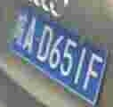
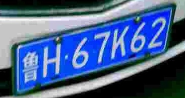
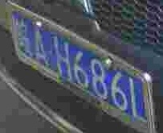
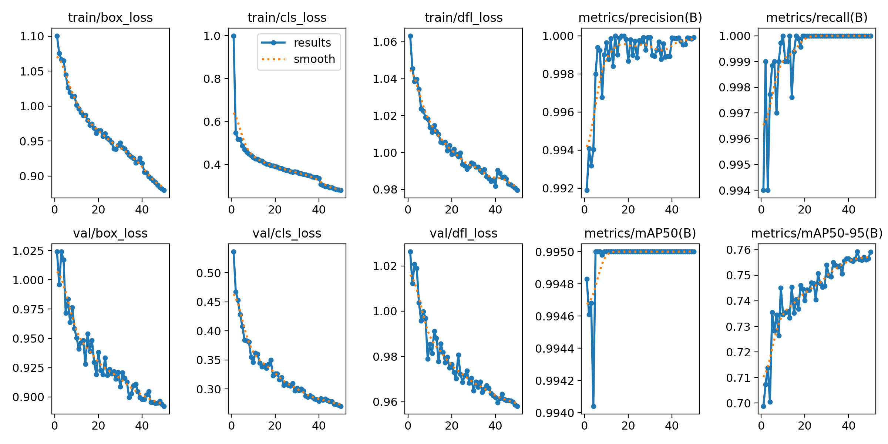
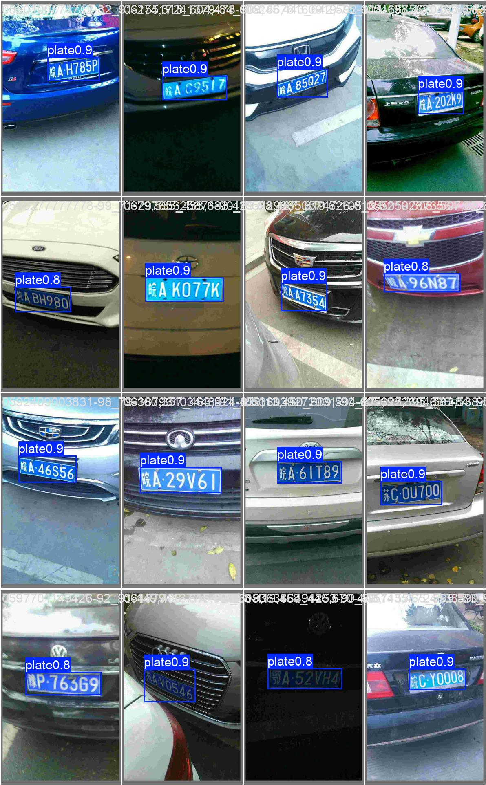

# 基于 YOLOv8 + CRNN 的车牌检测与识别

在 CCPD 数据集上实现完整的车牌识别流程：**YOLOv8n 定位车牌 → 裁剪 → 自己用 PyTorch 训练的 CRNN + CTC 读出车牌号**，并和 OpenCV 传统方法、PaddleOCR 通用模型做对比，最后在倾斜、恶劣天气等困难场景下测试鲁棒性。

```
原图 ──► YOLOv8n 检测车牌框 ──► 裁剪车牌 ──► CRNN + CTC ──► 「皖AYL250」
```

## 主要结果

| 指标 | 结果 |
|---|---|
| YOLOv8n 检测 mAP@0.5（测试集） | **99.5%** |
| YOLOv8n 检测 mAP@0.5:0.95 | 75.3% |
| 车牌识别准确率：PaddleOCR 通用模型 → 自训 CRNN | **65.8% → 99.4%** |
| 车牌定位准确率（IoU ≥ 0.7）：OpenCV 传统方法 → YOLOv8n | **50.7% → 99.2%** |
| 端到端识别准确率（检测 + 识别，整串车牌完全正确） | **99.7%** |

- 测试集为 CCPD 的 1000 张图片，训练时完全没有见过。
- 识别准确率要求 7 个字符**全部**正确才算对。
- 「定位正确」指预测框和真实框的 IoU ≥ 0.7，比常用的 0.5 更严格；没有检测到车牌也算错。

### 困难场景（每类 500 张）

| 场景 | 定位准确率（IoU ≥ 0.7） | 端到端识别准确率 |
|---|---|---|
| 正常 | 99.2% | 99.7% |
| 恶劣天气（雨、雪、雾） | 98.8% | 96.2% |
| 综合挑战 | 91.2% | 56.6% |
| 倾斜 | 84.0% | **46.8%** |

倾斜场景下定位仍有 84%，但识别只有 46.8%，说明主要问题出在识别阶段。

### 错误分析

对端到端评测中识别错误的车牌按错误类型统计（只统计检测到了车牌、但车牌号没读对的样本）：

| 错误类型 | 倾斜（262 张） | 综合挑战（216 张） | 恶劣天气（19 张） |
|---|---|---|---|
| 长度不对（漏字或多字） | **34%** | 31% | 16% |
| 只错 1 个字母或数字 | 29% | **36%** | **68%** |
| 只有省份汉字错 | 20% | 13% | 5% |
| 错 2 个及以上 | 17% | 20% | 11% |

| 漏字：皖AD651F → 皖A0651 | 省份认错：鲁H67K62 → 皖H67K62 | 单字认错：皖AH686L → 皖AH6861 |
|---|---|---|
|  |  |  |

主要发现：

1. **倾斜导致漏字**：车牌倾斜后，裁出的矩形里字符是斜着排列的，而 CRNN 是从左到右按列读取的，斜的字符会挤在同几列或被截断，造成漏字、多字。
2. **省份偏向「皖」**：CCPD 采集自安徽，训练集里绝大多数是「皖」牌，模型遇到外省车牌时容易把省份读成「皖」（如上图的「鲁」）。这是训练数据分布不均造成的偏差。
3. **相似字符混淆**：L/1、8/6、0/D 这类形状接近的字符，在模糊或光照差的情况下容易认错。

### 训练曲线与检测效果

**YOLOv8n 训练曲线**（损失和 mAP 随训练轮数的变化）



**测试集检测效果**（框上的数字是置信度）



## 方法

### 1. 数据准备（`prepare_data.py`）

CCPD 不需要人工标注，车牌位置和车牌号都写在文件名里。例如：

```
025-95_113-154&383_386&473-386&473_177&454_154&383_363&402-0_0_22_27_27_33_16-37-15.jpg
```

用 `-` 切开后，第 3 段是车牌框的左上角和右下角坐标，第 5 段是 7 个字符的编号，查表可得车牌号。脚本从 `ccpd_base` 中随机抽取图片：

- **检测数据**：训练 / 验证 / 测试 = 8000 / 1000 / 1000 张，生成 YOLO 格式标签
- **识别数据**：裁出车牌小图，训练集额外增加 4 万张，共 48000 张

图片在网络盘上读取较慢，因此用多线程并行读取。

### 2. 车牌检测：YOLOv8n

以 COCO 预训练的 YOLOv8n 为基础，在单一类别「车牌」上微调 50 轮，输入尺寸 640。

### 3. 车牌识别：CRNN + CTC（`train_crnn.py`）

- **CNN**：把 48×160 的车牌图压缩成 3×40 的特征图，只压缩高度、保留宽度方向的 40 列
- **双向 LSTM**：把 40 列当作 40 个时间步，结合左右上下文
- **CTC 损失**：只需要整串车牌号作为标签，不需要标注每个字符的位置；解码时合并相邻重复字符、去掉空白符号

训练 30 轮，Adam + 余弦学习率衰减，使用随机亮度作为数据增强。

### 4. 对比实验

- **PaddleOCR 基线**（`baseline_paddle.py`）：直接用 PP-OCRv5 通用识别模型读同一批车牌截图
- **OpenCV 传统方法**（`cv_baseline.py`）：HSV 蓝色区域提取 + 形态学闭运算 + 轮廓长宽比筛选
- **困难场景**（`make_hard.py`）：从 `ccpd_tilt`、`ccpd_weather`、`ccpd_challenge` 各抽 500 张

## 项目结构

```
plate-recognition/
├── prepare_data.py       # 从 CCPD 文件名生成检测数据和识别数据
├── ccpd.yaml             # YOLO 数据配置
├── train_crnn.py         # CRNN 模型定义、训练和评估
├── baseline_paddle.py    # PaddleOCR 通用模型基线
├── e2e_eval.py           # 端到端评测：YOLO → 裁剪 → CRNN
├── cv_baseline.py        # OpenCV 传统方法定位
├── make_hard.py          # 抽取困难场景测试图片
├── results.txt           # 全部实验结果
├── notebooks/
│   └── plate_recognition_kaggle.ipynb   # Kaggle 上一键运行的完整流程
└── assets/               # README 用到的图片
```

## 如何运行

整个项目在 **Kaggle Notebook**（免费 GPU T4）上完成：

1. 新建 Notebook，导入 `notebooks/plate_recognition_kaggle.ipynb`
2. 右侧面板 Accelerator 选 GPU T4 x2，打开 Internet，Input 中添加 CCPD 数据集（如 `ccpd-preprocess`）
3. 点 **Save Version → Save & Run All**，约 2 小时跑完，结果写在 `results.txt`

每一步都设置了超时上限并打印时间戳，某一步出问题时不会拖垮整个流程。

本地运行时，需要把各脚本开头的路径（`/kaggle/input/...`、`/kaggle/working/...`）改成自己的路径，并安装依赖：

```bash
pip install -r requirements.txt
```

## 局限与改进方向

- **倾斜车牌识别率低**：可以用 YOLOv8-pose 预测车牌四个角点（CCPD 文件名第 4 段就有角点标注），再做透视变换把车牌拉正后识别，针对的就是上面的「漏字」问题。
- **省份偏向「皖」**：CCPD 绝大多数是安徽「皖」牌、蓝牌、一图一牌。可以对外省样本过采样、合成其他省份的车牌，或加入 CCPD2020 绿牌数据。
- **部署**：可将两个模型导出为 ONNX，用 ONNX Runtime 或 TensorRT 加速推理。

## 数据集

[CCPD (Chinese City Parking Dataset)](https://github.com/detectRecog/CCPD)，Xu et al., *Towards End-to-End License Plate Detection and Recognition: A Large Dataset and Baseline*, ECCV 2018。
